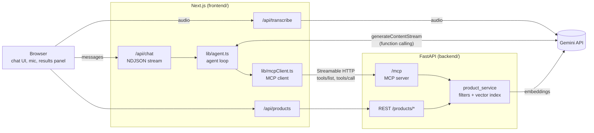

# [Voice Shopping Agent: MCP + Gemini](https://mcp-voice-app.manojkumargummadi.com/)

A voice-enabled shopping assistant that answers questions about a product catalog by calling tools on a
real **Model Context Protocol (MCP)** server.

- **Backend** (`backend/`): a FastAPI app that hosts an MCP server built with the official MCP Python SDK,
  served over Streamable HTTP at `/mcp`, plus a REST API over the same catalog logic. Semantic search uses
  Gemini embeddings and an in-memory vector index.
- **Frontend** (`frontend/`): a Next.js chat app. A server-side agent loop sends your message to Gemini,
  runs the tools Gemini asks for on the MCP server (through the official MCP TypeScript SDK), and streams
  the answer and every tool call back to the browser.

One provider and one key: everything runs on `GEMINI_API_KEY`, and the free tier is enough (a key from a
Google AI Studio project without billing works).

**Live demo:** <https://mcp-voice-app.manojkumargummadi.com/>. The "How it works" page in the app
covers the same ground as this README.

---

## Architecture



What happens when you ask something:

1. **Voice (optional).** The browser records up to 30 s with `MediaRecorder` and posts the audio to
   `/api/transcribe`, which asks Gemini (`GEMINI_TRANSCRIBE_MODEL`) for a transcript. The transcript is sent
   as a normal chat message.
2. **Agent.** `/api/chat` validates the conversation and runs `runAgent()` from `src/lib/agent.ts`. It
   connects to the MCP server, lists its tools, converts them to Gemini function declarations, and calls
   Gemini with function calling in `AUTO` mode.
3. **Tools.** When Gemini requests tool calls, the agent runs each one on the MCP server with `tools/call`
   and feeds the structured results back to the model. This repeats until the model answers in plain text,
   or until `AGENT_MAX_STEPS` is reached (the last step disables tools so the model has to answer).
4. **Streaming.** Every text delta, tool call and tool result goes to the browser as one NDJSON line, so the
   UI shows tool-call chips (tool name, arguments, result count) and product cards while the reply streams in.

Details: [docs/agent.md](docs/agent.md) (agent loop and stream protocol), [docs/mcp.md](docs/mcp.md)
(MCP server), [docs/semantic_search.md](docs/semantic_search.md) (embeddings and fallback).

## MCP server

Endpoint: `POST /mcp` (Streamable HTTP, stateless, JSON responses). Server name: `product-catalog`.

| Tool | Arguments | Returns |
|------|-----------|---------|
| `list_products` | none | Every product (`method: "catalog"`) |
| `search_products` | `colors?`, `city?`, `min_price?`, `max_price?`, `tags?` | Exact-attribute filter, all filters ANDed (`method: "filter"`) |
| `semantic_product_search` | `query`, `top_k` (1-50, default 5), plus the same optional filters | Results ranked by embedding similarity (`method: "semantic"`), or `"keyword_fallback"` if embeddings are unavailable |
| `get_product` | `product_id` | One product with specs, sizes and materials; a tool error if the id doesn't exist |

All four tools are annotated read-only and idempotent and declare typed input **and** output schemas, so
results come back as `structuredContent`. The server also exposes:

- **Resource** `catalog://products`: the whole catalog as JSON.
- **Prompt** `shopping_assistant(need)`: a starter prompt for a shopping conversation.

The REST API mirrors the tools: `GET /products`, `GET /products/{id}`, `POST /products/search`,
`POST /products/semantic-search`. There's also `GET /` (service index), `GET /healthz` and `GET /docs`
(Swagger UI).

### Connect another MCP client

Any MCP client that speaks Streamable HTTP can use the deployed backend:

```bash
# Claude Code
claude mcp add --transport http product-catalog https://<your-backend>.vercel.app/mcp

# MCP Inspector (choose "Streamable HTTP" and enter the /mcp URL)
npx @modelcontextprotocol/inspector
```

Or call it with curl:

```bash
curl -s http://localhost:8000/mcp \
  -H 'content-type: application/json' \
  -H 'accept: application/json, text/event-stream' \
  -d '{"jsonrpc":"2.0","id":1,"method":"tools/list"}'
```

## Tech stack

| Area | Technology |
|------|------------|
| Frontend | Next.js 16 (App Router, Node runtime routes), React 19, TypeScript, Tailwind CSS 4, lucide-react, react-markdown |
| Agent | `@google/genai` (Gemini function calling), `@modelcontextprotocol/sdk` (`StreamableHTTPClientTransport`), zod |
| Voice | `MediaRecorder` in the browser, Gemini audio understanding for transcription, browser `speechSynthesis` for optional spoken replies |
| Backend | Python 3.13, FastAPI, official MCP Python SDK (`mcp` 2.x, `MCPServer`), httpx, Pydantic |
| Search | Gemini `gemini-embedding-001` (768 dims) over plain HTTP, in-memory cosine index, keyword fallback |
| Tooling | pytest + anyio, ruff, mypy, ESLint 9, TypeScript `tsc` |
| Hosting | Vercel (two projects: frontend and backend) |

## Project structure

```
backend/
  main.py                  FastAPI app: CORS, REST routers, /mcp route
  mcp_server.py            MCP tools, resource, prompt; per-request Streamable HTTP endpoint
  config/settings.py       Environment-driven settings
  models/requests.py       Pydantic models shared by REST and MCP (filters, Product, ProductResults)
  routes/                  health.py (/, /healthz), products.py (/products/*)
  services/                product_service.py, embedding_service.py, vector_store.py
  utils/cache.py           Cached products.json loader
  data/products.json       The catalog
  tests/                   pytest suite (REST, semantic search, MCP)
frontend/src/
  app/page.tsx             Chat page (renders ShoppingAgent)
  app/about/page.tsx       "How it works" page
  app/api/chat/            Agent endpoint, streams NDJSON
  app/api/transcribe/      Speech-to-text with Gemini
  app/api/products/        Catalog proxy for the browse panel
  components/              ShoppingAgent, ChatMessage, ToolCallChip, ProductCard
  lib/                     agent.ts, mcpClient.ts, chatTypes.ts, config.ts, errors.ts, useChat, useRecorder, speech
docs/                      agent.md, mcp.md, semantic_search.md
scripts/test_mcp.js        Smoke test for a running MCP endpoint (no dependencies)
```

## Environment variables

Both packages ship a `.env.example` to copy.

**Frontend** (`frontend/.env.local`, or the Vercel project settings):

| Variable | Default | Purpose |
|----------|---------|---------|
| `GEMINI_API_KEY` | required | Chat agent and transcription |
| `GEMINI_MODEL` | `gemini-flash-latest` | Agent model |
| `GEMINI_TRANSCRIBE_MODEL` | `gemini-flash-lite-latest` | Speech-to-text model |
| `GEMINI_THINKING_LEVEL` | `low` | How much the chat model reasons first: `minimal`/`low`/`medium`/`high`; empty = model default |
| `BACKEND_INTERNAL_URL` | `http://localhost:8000` | Backend base URL; the agent connects to `${BACKEND_INTERNAL_URL}/mcp` |
| `AGENT_MAX_STEPS` | `5` | Maximum model calls per message |
| `GEMINI_BASE_URL` | unset | Optional Gemini API base URL override (a proxy, or a local mock) |

**Backend** (`backend/.env`, or the Vercel project settings):

| Variable | Default | Purpose |
|----------|---------|---------|
| `GEMINI_API_KEY` | unset | Embeddings for semantic search. Without it, semantic search uses keyword matching |
| `EMBEDDING_MODEL` | `gemini-embedding-001` | Embedding model |
| `EMBEDDING_DIMENSIONS` | `768` | Output dimensionality |
| `EMBEDDING_TIMEOUT_S` | `30` | HTTP timeout for embedding calls |
| `GEMINI_API_BASE` | `https://generativelanguage.googleapis.com/v1beta` | Gemini REST base URL |
| `SEMANTIC_DEFAULT_TOP_K` | `5` | Used when a request sends `top_k: null` |
| `SEMANTIC_MIN_SIMILARITY` | `0.0` | Drop semantic results below this cosine similarity |
| `ALLOWED_ORIGINS` | `http://localhost:3000` | Comma-separated CORS origins (browsers only; the frontend calls the backend server-side) |

Model names are all configurable, so when a provider retires a model you change a setting, not code.

## Local development

Prerequisites: Python 3.13, Node.js 20.9 or later, and a Gemini API key.

```bash
# Backend: http://localhost:8000 (MCP at /mcp, Swagger at /docs)
cd backend
python3.13 -m venv .venv && source .venv/bin/activate
pip install -r requirements.txt
cp .env.example .env            # then set GEMINI_API_KEY
uvicorn main:app --reload --port 8000
```

```bash
# Frontend: http://localhost:3000
cd frontend
npm ci
cp .env.example .env.local      # then set GEMINI_API_KEY
npm run dev
```

`requirements.txt` has the runtime dependencies only. For the dev tools, run
`pip install pytest anyio ruff mypy` or use Poetry (`poetry install`), which reads `pyproject.toml`.

### Docker Compose

```bash
GEMINI_API_KEY=your-key docker compose up --build
```

This builds both images and starts the backend on port 8000 and the frontend on port 3000, with the
frontend pointed at `http://backend:8000`. Compose also reads `GEMINI_API_KEY` from a `.env` file in the
repo root.

## Tests and checks

```bash
# backend/
pytest          # REST, semantic search (fake embedder), MCP via the official client and raw HTTP
ruff check .
mypy .

# frontend/
npm run lint
npm run typecheck
npm run build

# against a running backend (defaults to http://localhost:8000)
BACKEND_URL=https://<your-backend>.vercel.app node scripts/test_mcp.js
```

The backend tests never call Gemini: `conftest.py` removes `GEMINI_API_KEY`, and the ranking tests use a
deterministic fake embedder.

## Deployment

The app runs as two Vercel projects in this repo:

1. **Backend**, root directory `backend/`. `vercel.json` builds `main.py` with `@vercel/python` and routes
   every path to it. Set `GEMINI_API_KEY`, plus `ALLOWED_ORIGINS` if browsers will call the API directly.
2. **Frontend**, root directory `frontend/` (Next.js preset). Set `GEMINI_API_KEY` and
   `BACKEND_INTERNAL_URL` (the backend's public URL, without `/mcp`). The other variables are optional.

The MCP endpoint creates a fresh stateless session manager for every request, so it doesn't depend on
lifespan events or in-memory sessions surviving between serverless invocations. The vector index is built
lazily on the first semantic search in each warm instance.

## License

MIT
